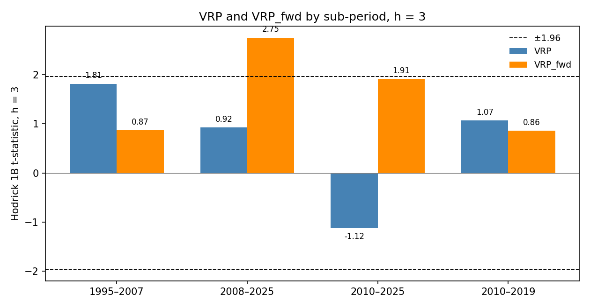

# Spec 003 — Inference

## Definitions

Spec 001 and spec 002 are imported and not modified. The monthly series are the spec 001 panel: `^GSPC`, implied variance from `data/vix_1990_data.csv`, and TB3MS lagged one month. VRP and VRP_fwd are in monthly percent squared. The dependent variable is specification (B): the h-month average excess return multiplied by 1200, in annualized percent. Horizons are h = 1, 3 and 6. Newey–West standard errors are `statsmodels` HAC with the Bartlett kernel and `use_correction=False`. t(h−1) uses maxlags = max(1, h−1). t(h) uses maxlags = h. t(2h) uses maxlags = 2h. R² is in percent.

Part A drops regression row t when any month in t, t+1, …, t+h falls in C = {2008-09, 2008-10, 2008-11, 2008-12, 2020-02, 2020-03, 2020-04}. The monthly series themselves are not deleted. A kept row still has its own VRP.

Hodrick (1992) estimator 1B uses the monthly excess return in annualized percent, e, and the null residual u = e − mean(e) on the row's calendar window. z_t = (1, x_t)'. For the sum of h monthly returns, w_t = u_{t+1} times the sum of z_{t}, z_{t−1}, …, z_{t−h+1}. The sum is over dates t with t−h+1 inside the window and t+1 inside the window. A Part A date is left out of that sum, because it is not part of the regression being tested. On every row below, that date set has the same length T as the regression. S and Z are the averages of w_t w_t' and z_t z_t' on that date set. V_sum = Z⁻¹ S Z⁻¹ / T, and V for the average-return coefficient is V_sum / h². The t-statistic divides coef(B) from the average regression by the square root of V[1, 1].

The bootstrap imposes no predictability. μ is the mean of e on the row's calendar window, and the regressor is an AR(1) fit by OLS on that same window, including months that Part A drops from the regression. Residuals (ε_s, η_s) are drawn as pairs from the same month. x* starts at the sample's first x. e* on that first month is μ, because the AR(1) residual starts one month later; the first return is not inside any Y. Each later month is x*_t = c + ρ x*_{t−1} + η*_t and e*_t = μ + ε*_t. Y*(h) is the spec 001 forward average of e*, scaled as specification (B) because e* is already in annualized percent. One artificial sample is used for h = 1, 3 and 6. The iid scheme draws pairs independently. The block scheme is the Politis–Romano stationary bootstrap on the pairs, circular, with mean block length 6. There are 5,000 replications per row and scheme, from `numpy.random.default_rng(20261021)`, in the order R-base, R-full, R-D1, R-G, R-G07, and within each row the iid scheme then the block scheme. The null-mean of coef(B) in the table is the mean under the iid scheme. That is the Stambaugh bias for this design.

## Part A — window-overlap exclusion

D1 is VRP on 1990–2025. D2 is VRP on 2010–2025. D3 is VRP_fwd on 1995–2025. t(h−1) uses maxlags = max(1, h−1). t(h) uses maxlags = h.

| variant | h | coef(B) | t(h−1) | t(h) | R² | N | rows dropped |
|---|---|---|---|---|---|---|---|
| D1 | 1 | 0.3996 | 2.09 | 2.09 | 2.22 | 422 | 9 |
| D1 | 3 | 0.2455 | 2.25 | 2.26 | 2.89 | 416 | 13 |
| D1 | 6 | 0.1454 | 1.77 | 1.77 | 2.10 | 407 | 19 |
| D2 | 1 | 0.5184 | 1.76 | 1.76 | 5.25 | 187 | 4 |
| D2 | 3 | 0.1141 | 0.93 | 0.92 | 1.05 | 183 | 6 |
| D2 | 6 | 0.0571 | 0.60 | 0.59 | 0.59 | 177 | 9 |
| D3 | 1 | 0.4308 | 2.12 | 2.12 | 2.01 | 362 | 9 |
| D3 | 3 | 0.2946 | 2.74 | 2.70 | 3.25 | 356 | 13 |
| D3 | 6 | 0.2005 | 2.22 | 2.19 | 3.07 | 347 | 19 |

D1, h = 1, drops 9 rows (N = 422): 2008-08, 2008-09, 2008-10, 2008-11, 2008-12, 2020-01, 2020-02, 2020-03, 2020-04.

D1, h = 3, drops 13 rows (N = 416): 2008-06, 2008-07, 2008-08, 2008-09, 2008-10, 2008-11, 2008-12, 2019-11, 2019-12, 2020-01, 2020-02, 2020-03, 2020-04.

D1, h = 6, drops 19 rows (N = 407): 2008-03, 2008-04, 2008-05, 2008-06, 2008-07, 2008-08, 2008-09, 2008-10, 2008-11, 2008-12, 2019-08, 2019-09, 2019-10, 2019-11, 2019-12, 2020-01, 2020-02, 2020-03, 2020-04.

D2, h = 1, drops 4 rows (N = 187): 2020-01, 2020-02, 2020-03, 2020-04.

D2, h = 3, drops 6 rows (N = 183): 2019-11, 2019-12, 2020-01, 2020-02, 2020-03, 2020-04.

D2, h = 6, drops 9 rows (N = 177): 2019-08, 2019-09, 2019-10, 2019-11, 2019-12, 2020-01, 2020-02, 2020-03, 2020-04.

D3, h = 1, drops 9 rows (N = 362): 2008-08, 2008-09, 2008-10, 2008-11, 2008-12, 2020-01, 2020-02, 2020-03, 2020-04.

D3, h = 3, drops 13 rows (N = 356): 2008-06, 2008-07, 2008-08, 2008-09, 2008-10, 2008-11, 2008-12, 2019-11, 2019-12, 2020-01, 2020-02, 2020-03, 2020-04.

D3, h = 6, drops 19 rows (N = 347): 2008-03, 2008-04, 2008-05, 2008-06, 2008-07, 2008-08, 2008-09, 2008-10, 2008-11, 2008-12, 2019-08, 2019-09, 2019-10, 2019-11, 2019-12, 2020-01, 2020-02, 2020-03, 2020-04.

On the 1990–2025 and 1995–2025 calendars, the h = 3 list is 2008-06 through 2008-12 and 2019-11 through 2020-04. D2 starts in 2010, so only the second block is in its sample.

## Part B — variant G

G on 1995-01 through 2007-12 is the regression the HAR burn-in actually identifies. It is the same estimation sample as spec 002's row "G 1990-2007", which started the calendar in 1990 and then dropped months with no forecast. Columns match the spec 002 table.

| sample | h | coef(B) | t(h−1) | t(h) | R² | N |
|---|---|---|---|---|---|---|
| G 1995-01 → 2007-12 | 1 | 0.1940 | 0.68 | 0.68 | 0.41 | 155 |
| G 1995-01 → 2007-12 | 3 | 0.1472 | 0.99 | 1.04 | 0.73 | 153 |
| G 1995-01 → 2007-12 | 6 | 0.0676 | 0.72 | 0.73 | 0.31 | 150 |

Influence is the full-sample G regression, VRP_fwd on 1995–2025, at h = 3. DFBETA is coef(B) minus the coefficient without that row. The five largest |DFBETA| rows:

| date | VRP_fwd_t | Y_t | DFBETA | Cook's D |
|---|---|---|---|---|
| 2008-10 | -277.41 | -64.12 | -0.0669 | 0.4863 |
| 1998-08 | -53.57 | 73.59 | -0.0317 | 0.1214 |
| 2008-09 | -36.28 | -102.92 | 0.0243 | 0.0782 |
| 2009-02 | 72.34 | 89.15 | 0.0211 | 0.0548 |
| 2008-11 | -31.53 | -79.40 | 0.0167 | 0.0385 |

VRP and VRP_fwd in monthly percent squared:

| date | VRP | VRP_fwd |
|---|---|---|
| 2008-10 | -274.11 | -277.41 |
| 2020-03 | -508.51 | 28.29 |
| 2025-04 | -138.42 | 35.96 |

AR(1) slope on 1995-01 through 2025-12: VRP 0.126, VRP_fwd 0.341.

## Inference

t_NW(h−1) uses maxlags = max(1, h−1). t_NW(2h) uses maxlags = 2h. t_1B is the Hodrick statistic. Bootstrap p-values are two-sided shares of replications at least as large as the observed statistic in absolute value. The null-mean of the coefficient is the iid scheme. R² is in percent.

| id | h | coef(B) | null-mean coef | t_NW(h−1) | t_NW(2h) | t_1B | p_NW iid | p_NW block | p_1B iid | p_1B block | R² | N |
|---|---|---|---|---|---|---|---|---|---|---|---|---|
| R-base | 1 | 0.3879 | 0.0061 | 1.63 | 1.89 | 1.44 | 0.1268 | 0.3432 | 0.1530 | 0.3520 | 1.36 | 215 |
| R-base | 3 | 0.4196 | 0.0062 | 3.46 | 3.95 | 2.22 | 0.0020 | 0.1668 | 0.0230 | 0.2468 | 4.98 | 213 |
| R-base | 6 | 0.2882 | 0.0059 | 2.98 | 3.56 | 1.86 | 0.0120 | 0.1698 | 0.0638 | 0.2786 | 4.92 | 210 |
| R-full | 1 | 0.0665 | 0.0002 | 0.32 | 0.31 | 0.40 | 0.7816 | 0.8218 | 0.7202 | 0.7932 | 0.21 | 431 |
| R-full | 3 | 0.0908 | 0.0004 | 0.70 | 0.66 | 1.30 | 0.5672 | 0.6570 | 0.1962 | 0.5192 | 1.20 | 429 |
| R-full | 6 | 0.0345 | 0.0003 | 0.49 | 0.50 | 0.64 | 0.6914 | 0.7230 | 0.5368 | 0.6890 | 0.33 | 426 |
| R-D1 | 1 | 0.3996 | 0.0008 | 2.09 | 2.12 | 2.05 | 0.0890 | 0.3342 | 0.0264 | 0.2486 | 2.22 | 422 |
| R-D1 | 3 | 0.2455 | -0.0003 | 2.25 | 2.30 | 2.14 | 0.0892 | 0.2856 | 0.0254 | 0.2738 | 2.89 | 416 |
| R-D1 | 6 | 0.1454 | -0.0001 | 1.77 | 1.78 | 0.87 | 0.1658 | 0.3112 | 0.3978 | 0.5834 | 2.10 | 407 |
| R-G | 1 | 0.4176 | -0.0039 | 3.34 | 3.57 | 2.03 | 0.0060 | 0.2790 | 0.0370 | 0.3574 | 3.17 | 371 |
| R-G | 3 | 0.3256 | -0.0015 | 5.23 | 5.37 | 2.78 | 0.0004 | 0.1110 | 0.0040 | 0.1868 | 5.87 | 369 |
| R-G | 6 | 0.1854 | -0.0007 | 3.52 | 3.49 | 2.13 | 0.0074 | 0.1702 | 0.0364 | 0.2644 | 3.53 | 366 |
| R-G07 | 1 | 0.1940 | 0.0057 | 0.68 | 0.75 | 0.63 | 0.5220 | 0.5140 | 0.5442 | 0.5200 | 0.41 | 155 |
| R-G07 | 3 | 0.1472 | 0.0057 | 0.99 | 1.17 | 0.87 | 0.4026 | 0.4660 | 0.4024 | 0.4766 | 0.73 | 153 |
| R-G07 | 6 | 0.0676 | 0.0056 | 0.72 | 0.76 | 0.49 | 0.5420 | 0.5716 | 0.6482 | 0.6240 | 0.31 | 150 |

Empirical size of the nominal 5% test: the share of replications with an absolute t-statistic above 1.96.

| id | h | NW iid | 1B iid | NW block | 1B block |
|---|---|---|---|---|---|
| R-base | 1 | 6.84% | 4.80% | 21.60% | 13.34% |
| R-base | 3 | 7.88% | 4.86% | 61.92% | 38.00% |
| R-base | 6 | 8.42% | 4.78% | 44.98% | 23.26% |
| R-full | 1 | 11.70% | 3.94% | 35.56% | 26.82% |
| R-full | 3 | 12.94% | 4.68% | 32.38% | 33.22% |
| R-full | 6 | 13.04% | 4.74% | 27.44% | 15.66% |
| R-D1 | 1 | 11.18% | 3.64% | 35.62% | 27.30% |
| R-D1 | 3 | 13.08% | 4.48% | 32.80% | 32.80% |
| R-D1 | 6 | 13.00% | 4.74% | 27.82% | 15.58% |
| R-G | 1 | 8.36% | 4.60% | 63.32% | 39.82% |
| R-G | 3 | 10.92% | 4.50% | 67.20% | 52.34% |
| R-G | 6 | 11.78% | 5.00% | 53.00% | 33.38% |
| R-G07 | 1 | 7.26% | 4.84% | 7.74% | 2.14% |
| R-G07 | 3 | 9.62% | 5.16% | 15.34% | 8.08% |
| R-G07 | 6 | 10.30% | 5.14% | 11.60% | 5.50% |

Hodrick standard error at h = 1 divided by the White HC0 standard error:

| id | ratio |
|---|---|
| R-base | 1.038 |
| R-full | 0.868 |
| R-D1 | 0.972 |
| R-G | 1.568 |
| R-G07 | 1.031 |

## Checks

### 1. Earlier coefficients and Newey–West t-statistics

Pass, to 1e-6, against the saved spec 001 and spec 002 tables. R-base matches the spec 001 main sample at h = 1, 3 and 6. R-full matches spec 001 sample R2, which is spec 002 row 0. R-G matches spec 002 "G full sample". R-G07 matches spec 002 "G 1990-2007". The reference values at h = 3 are R-base 0.4196 / 3.46, R-full 0.0908 / 0.70, and R-G 0.3256 / 5.23. R-D1 is a new sample. Its coef(B) and t(h−1) are the Part A D1 estimates, from the same `fit_hac` call.

### 2. Hodrick at h = 1 against White HC0

The null-residual ratio is inside [0.9, 1.1] for R-base, R-D1, R-G07. It is outside that band for R-full 0.868, R-G 1.568. All five ratios: R-base 1.038, R-full 0.868, R-D1 0.972, R-G 1.568, R-G07 1.031. The estimator was not replaced. u = e − mean(e) and the OLS residual differ when a month has a regressor far from its mean and a return that the fitted line absorbs. On R-G the largest such month is 2008-10: VRP_fwd is far below its mean and the next return is largely what that level predicts, so the OLS residual is small and the null residual is not. On every row, the same Hodrick sandwich with the OLS residual in place of the null residual reproduces the HC0 standard error to 1e-8. A simulated-data check does the same.

### 3. Bootstrap centering and the AR(1) slopes

The iid scheme passes. For every row and horizon, the mean of t*_NW under iid draws is inside ±0.15. The block scheme does not: R-base h=1 (1.28), R-base h=3 (2.32), R-base h=6 (1.83), R-full h=1 (0.81), R-full h=3 (1.14), R-full h=6 (0.76), R-D1 h=1 (0.80), R-D1 h=3 (1.14), R-D1 h=6 (0.75), R-G h=1 (2.52), R-G h=3 (2.89), R-G h=6 (2.12), R-G07 h=1 (0.68), R-G07 h=3 (0.90), R-G07 h=6 (0.58).

The block bootstrap draws consecutive pairs (ε_s, η_s). Inside a block, η at one month stays next to ε at the following month. That lead-lag correlation is the sample predictability, because ε is e − μ and not a residual from a regression on lagged x. With mean block length 6, about five sixths of the month-to-month steps keep the historical successor, so the block distribution sits near the sample coefficient rather than near 0. The iid scheme breaks that link and keeps only the contemporaneous Stambaugh correlation. The block p-values and the block rejection shares are computed exactly as specified. They are not null p-values or null sizes.

| id | ρ | mean t*_NW, iid, h=1 / 3 / 6 | mean t*_NW, block, h=1 / 3 / 6 |
|---|---|---|---|
| R-base | 0.174 | 0.028 / 0.060 / 0.089 | 1.283 / 2.317 / 1.828 |
| R-full | 0.129 | -0.065 / -0.033 / -0.018 | 0.809 / 1.145 / 0.759 |
| R-D1 | 0.129 | -0.053 / -0.046 / -0.035 | 0.802 / 1.145 / 0.753 |
| R-G | 0.341 | -0.057 / -0.037 / -0.027 | 2.517 / 2.888 / 2.121 |
| R-G07 | 0.304 | 0.042 / 0.060 / 0.084 | 0.681 / 0.899 / 0.581 |

R-full and R-D1 share the 1990–2025 VRP series, so they share ρ. Part A changes the regression rows, not the AR(1).

### 4. Part A drops, and nothing that remains touches C

Pass. The dropped rows are listed in Part A. For every kept regression row, at every horizon of D1, D2 and D3, none of t, t+1, …, t+h is in C. The h = 3 list on D1 and on D3 is the list named in the spec.

### 5. No look-ahead

Pass, on the spec 001 rule, for 6345 regression rows: R-base, R-full, R-D1, R-G, R-G07, D2 and D3, at h = 1, 3 and 6. D1 is R-D1 and is not counted twice. For each row t, the last daily-return date inside RV_t and the last VIX date inside IV_t fall in month t, and the later of those dates is on or before the month-end label. The first excess return inside Y_t is the return of month t+1, and the window runs through month t+h, inside that row's sample. VRP_fwd is the spec 002 real-time HAR forecast. This check does not reopen that construction.

## Flags at h = 3

The flags are independent. F1, F2 and F3 are properties of the named row. F4 is a property of D2, so it is the same fact in both columns. A flag uses the inequalities written in the spec: Hodrick |t| above 1.96, bootstrap p-values below 0.05, NW size above 8%, |DFBETA| above half of |coef(B)|, and the D2 t-statistic above 1.96. F1 and F2 use the block numbers as computed. Check 3 says the block distribution is not centered at 0, so those two flags' block legs are not null tests.

| flag | R-base | R-G |
|---|---|---|
| F1 survives conservative inference | no. t_1B = 2.22, p_NW iid = 0.0020, p_NW block = 0.1668 | no. t_1B = 2.78, p_NW iid = 0.0004, p_NW block = 0.1110 |
| F2 NW is oversized | iid no (7.88%); block yes (61.92%) | iid yes (10.92%); block yes (67.20%) |
| F3 single-row influence | no. Largest |DFBETA| / |coef(B)| = 0.151 at 1998-08 | no. Largest |DFBETA| / |coef(B)| = 0.206 at 2008-10 |
| F4 2020 explains the post-2010 failure | no. D2 t(h−1) = 0.93 | no. D2 t(h−1) = 0.93 |

F4 does not hold. On 2010–2025, after the overlap exclusion, the h = 3 Newey–West t-statistic is 0.93.

On the iid scheme, the one centered at 0, R-base and R-G at h = 3 have a Hodrick absolute t-statistic above 1.96 and a Newey–West bootstrap p-value below 0.05. F1 is no because the block p-value is above 0.05, and check 3 says that p-value is not a null p-value.

## Comparison with BTZ

The Hodrick t-statistic for R-base at h = 3 is 2.22. BTZ Table 2 reports 2.86. The gap is -0.64.

The gap is larger than 0.15, the distance fixed before the run as the reading of "close". The Hodrick t-statistic is not close to 2.86. No other standard-error estimator was computed.

## Deviations from this spec

1. **Check 2's 10% band does not hold for every row.** The Hodrick formula uses the null residual. That standard error is outside 10% of HC0 for R-full, R-G. The code asserts a different identity: the same sandwich with the OLS residual equals the HC0 standard error. That identity holds. The null residual was kept.

2. **Check 3 does not hold for the block scheme.** The iid mean of t*_NW is inside ±0.15 for every row and horizon. The stationary bootstrap on the pairs keeps the sample lead-lag between η and the next ε, so its mean tracks the sample t-statistic. Outside the band: R-base h=1, R-base h=3, R-base h=6, R-full h=1, R-full h=3, R-full h=6, R-D1 h=1, R-D1 h=3, R-D1 h=6, R-G h=1, R-G h=3, R-G h=6, R-G07 h=1, R-G07 h=3, R-G07 h=6. The resampling rule was not changed.

The spec left four choices implicit. They are fixed in the definitions above, and they are not further deviations: Hodrick's Z and S use the dates on which w_t is defined, and a Part A date is removed from that sum as well as from the regression; the AR(1) and μ use every month of the calendar window; the first bootstrap return is μ; and each replication builds one monthly sample, from which all three horizons are formed. The null-mean of coef(B) stored in `table_inference.csv` is the iid mean.

## 003a — Wild bootstrap, matched samples, horse race

This section is written by `src/inference_003a.py`. It imports `src/inference.py` and the spec 001 and spec 002 modules and does not modify them. Everything above this section is the spec 003 run as committed. `table_inference.csv` and `table_size.csv` now come from this section: the block columns are removed, wild columns replace them, and the new rows are appended.

### Wild bootstrap

Each replication draws w_s, ±1 with probability 1/2, for every date s of the AR(1) innovations. ε*_s = w_s ε_s and η*_s = w_s η_s, so both members of a pair get the same sign, and the dates keep their order. x* and e* are then built exactly as in spec 003 C3. The weight keeps each month's variance and the contemporaneous ε–η product, and its independence across months removes every lead-lag between η_s and ε_{s+1}.

There are 5,000 replications per row and scheme. For the five spec 003 rows, the iid draws are the spec 003 draws: the spec 003 generator is replayed, and its block draws are taken and discarded. The code checks the replay against the spec 003 h = 3 values for R-base and R-G. All wild draws, and the iid draws for the new rows, come from a second `numpy.random.default_rng(20261021)`, in the order R-base, R-full, R-D1, R-G, R-G07, V-95-07, G-95-07, V-08-25, G-08-25, V-10-25, G-10-25, V-10-19, G-10-19, R-D3; within a new row, iid then wild.

### Unit tests

**Check 2, replaced.** At h = 1, the 1B sandwich with the OLS residual in place of u_{t+1} equals the White HC0 standard error. Pass, to 1e-6. The largest relative gap is 1.6e-15 over the 14 rows, 4.9e-15 over the three horse-race samples (both slopes), and below 1e-6 on simulated data with one and with two regressors.

**Generalized Hodrick.** `hodrick_t` in `src/inference_003a.py` takes k regressors, with z_t = (1, x_t')'. With the second regressor removed, its output equals `inference.hodrick_t` to 1e-12: on simulated data at h = 1, 3 and 6, and on every row of this section, where the matched-sample and bootstrap t-statistics are computed with the new function.

For information, the null-residual 1B / HC0 ratio at h = 1. It is not expected to be 1, because 1B uses the null residual by construction.

| id | ratio |
|---|---|
| R-base | 1.038 |
| R-full | 0.868 |
| R-D1 | 0.972 |
| R-G | 1.568 |
| R-G07 | 1.031 |
| V-95-07 | 1.038 |
| G-95-07 | 1.031 |
| V-08-25 | 0.908 |
| G-08-25 | 1.529 |
| V-10-25 | 1.668 |
| G-10-25 | 1.123 |
| V-10-19 | 2.468 |
| G-10-19 | 1.309 |
| R-D3 | 1.072 |

### Inference, all rows

Columns as in spec 003, with wild in place of block. The null-mean of coef(B) is the iid mean. R² is in percent.

| id | h | coef(B) | null-mean coef | t_NW(h−1) | t_NW(2h) | t_1B | p_NW iid | p_NW wild | p_1B iid | p_1B wild | R² | N |
|---|---|---|---|---|---|---|---|---|---|---|---|---|
| R-base | 1 | 0.3879 | 0.0061 | 1.63 | 1.89 | 1.44 | 0.1268 | 0.1156 | 0.1530 | 0.1490 | 1.36 | 215 |
| R-base | 3 | 0.4196 | 0.0062 | 3.46 | 3.95 | 2.22 | 0.0020 | 0.0068 | 0.0230 | 0.0236 | 4.98 | 213 |
| R-base | 6 | 0.2882 | 0.0059 | 2.98 | 3.56 | 1.86 | 0.0120 | 0.0194 | 0.0638 | 0.0664 | 4.92 | 210 |
| R-full | 1 | 0.0665 | 0.0002 | 0.32 | 0.31 | 0.40 | 0.7816 | 0.8286 | 0.7202 | 0.7666 | 0.21 | 431 |
| R-full | 3 | 0.0908 | 0.0004 | 0.70 | 0.66 | 1.30 | 0.5672 | 0.6154 | 0.1962 | 0.1968 | 1.20 | 429 |
| R-full | 6 | 0.0345 | 0.0003 | 0.49 | 0.50 | 0.64 | 0.6914 | 0.7286 | 0.5368 | 0.5340 | 0.33 | 426 |
| R-D1 | 1 | 0.3996 | 0.0008 | 2.09 | 2.12 | 2.05 | 0.0890 | 0.0652 | 0.0264 | 0.0384 | 2.22 | 422 |
| R-D1 | 3 | 0.2455 | -0.0003 | 2.25 | 2.30 | 2.14 | 0.0892 | 0.0536 | 0.0254 | 0.0190 | 2.89 | 416 |
| R-D1 | 6 | 0.1454 | -0.0001 | 1.77 | 1.78 | 0.87 | 0.1658 | 0.1124 | 0.3978 | 0.0996 | 2.10 | 407 |
| R-G | 1 | 0.4176 | -0.0039 | 3.34 | 3.57 | 2.03 | 0.0060 | 0.0254 | 0.0370 | 0.0336 | 3.17 | 371 |
| R-G | 3 | 0.3256 | -0.0015 | 5.23 | 5.37 | 2.78 | 0.0004 | 0.0014 | 0.0040 | 0.0018 | 5.87 | 369 |
| R-G | 6 | 0.1854 | -0.0007 | 3.52 | 3.49 | 2.13 | 0.0074 | 0.0460 | 0.0364 | 0.0336 | 3.53 | 366 |
| R-G07 | 1 | 0.1940 | 0.0057 | 0.68 | 0.75 | 0.63 | 0.5220 | 0.5234 | 0.5442 | 0.5340 | 0.41 | 155 |
| R-G07 | 3 | 0.1472 | 0.0057 | 0.99 | 1.17 | 0.87 | 0.4026 | 0.4110 | 0.4024 | 0.3842 | 0.73 | 153 |
| R-G07 | 6 | 0.0676 | 0.0056 | 0.72 | 0.76 | 0.49 | 0.5420 | 0.5490 | 0.6482 | 0.6160 | 0.31 | 150 |
| V-95-07 | 1 | 0.3640 | 0.0081 | 1.37 | 1.62 | 1.22 | 0.1974 | 0.1908 | 0.2314 | 0.2270 | 1.31 | 155 |
| V-95-07 | 3 | 0.3729 | 0.0080 | 2.82 | 3.24 | 1.81 | 0.0164 | 0.0292 | 0.0672 | 0.0728 | 4.24 | 153 |
| V-95-07 | 6 | 0.2838 | 0.0068 | 2.76 | 3.35 | 1.69 | 0.0186 | 0.0340 | 0.0900 | 0.1028 | 4.91 | 150 |
| G-95-07 | 1 | 0.1940 | 0.0162 | 0.68 | 0.75 | 0.63 | 0.5366 | 0.5396 | 0.5572 | 0.5430 | 0.41 | 155 |
| G-95-07 | 3 | 0.1472 | 0.0101 | 0.99 | 1.17 | 0.87 | 0.4086 | 0.4190 | 0.4092 | 0.3868 | 0.73 | 153 |
| G-95-07 | 6 | 0.0676 | 0.0044 | 0.72 | 0.76 | 0.49 | 0.5352 | 0.5490 | 0.6336 | 0.6138 | 0.31 | 150 |
| V-08-25 | 1 | 0.0453 | -0.0007 | 0.21 | 0.20 | 0.26 | 0.8662 | 0.8822 | 0.8352 | 0.8518 | 0.16 | 215 |
| V-08-25 | 3 | 0.0673 | -0.0008 | 0.51 | 0.48 | 0.92 | 0.6770 | 0.7148 | 0.3698 | 0.3848 | 1.06 | 213 |
| V-08-25 | 6 | 0.0178 | -0.0010 | 0.26 | 0.27 | 0.32 | 0.8394 | 0.8596 | 0.7610 | 0.7522 | 0.13 | 210 |
| G-08-25 | 1 | 0.5041 | 0.0024 | 3.37 | 3.57 | 1.99 | 0.0106 | 0.0320 | 0.0408 | 0.0300 | 5.66 | 215 |
| G-08-25 | 3 | 0.3925 | 0.0017 | 5.02 | 5.70 | 2.75 | 0.0016 | 0.0096 | 0.0046 | 0.0002 | 10.63 | 213 |
| G-08-25 | 6 | 0.2339 | 0.0008 | 3.27 | 3.75 | 2.32 | 0.0268 | 0.1332 | 0.0192 | 0.0176 | 6.75 | 210 |
| V-10-25 | 1 | -0.1237 | 0.0012 | -0.87 | -0.83 | -0.60 | 0.5284 | 0.8798 | 0.6290 | 0.8276 | 1.16 | 191 |
| V-10-25 | 3 | -0.0724 | 0.0006 | -1.59 | -1.50 | -1.12 | 0.2690 | 0.5624 | 0.3042 | 0.3194 | 1.58 | 189 |
| V-10-25 | 6 | -0.0459 | 0.0002 | -1.47 | -1.74 | -1.11 | 0.2924 | 0.5294 | 0.2776 | 0.3040 | 1.54 | 186 |
| G-10-25 | 1 | 0.7478 | 0.0101 | 2.56 | 2.85 | 2.08 | 0.0228 | 0.0384 | 0.0360 | 0.0354 | 4.86 | 191 |
| G-10-25 | 3 | 0.4007 | 0.0063 | 3.01 | 2.87 | 1.91 | 0.0134 | 0.0148 | 0.0596 | 0.0510 | 5.52 | 189 |
| G-10-25 | 6 | 0.3238 | 0.0046 | 3.18 | 2.82 | 1.99 | 0.0134 | 0.0122 | 0.0478 | 0.0430 | 8.76 | 186 |
| V-10-19 | 1 | 0.8563 | 0.0029 | 4.61 | 5.30 | 1.79 | 0.0006 | 0.0158 | 0.0720 | 0.0484 | 11.03 | 119 |
| V-10-19 | 3 | 0.1664 | -0.0013 | 1.67 | 1.65 | 1.07 | 0.1104 | 0.1736 | 0.2844 | 0.3258 | 1.65 | 117 |
| V-10-19 | 6 | 0.0856 | -0.0022 | 1.03 | 1.17 | 0.83 | 0.3494 | 0.4516 | 0.4110 | 0.4418 | 1.18 | 114 |
| G-10-19 | 1 | 0.6809 | 0.0083 | 2.04 | 2.31 | 1.44 | 0.0684 | 0.1590 | 0.1428 | 0.1576 | 4.93 | 119 |
| G-10-19 | 3 | 0.2183 | 0.0046 | 1.51 | 1.54 | 0.86 | 0.1854 | 0.2836 | 0.3978 | 0.4350 | 2.01 | 117 |
| G-10-19 | 6 | 0.2280 | 0.0043 | 1.98 | 2.14 | 1.26 | 0.1016 | 0.1538 | 0.2072 | 0.2210 | 6.04 | 114 |
| R-D3 | 1 | 0.4308 | -0.0029 | 2.12 | 2.28 | 1.91 | 0.0614 | 0.0670 | 0.0530 | 0.0602 | 2.01 | 362 |
| R-D3 | 3 | 0.2946 | -0.0015 | 2.74 | 2.63 | 2.07 | 0.0314 | 0.0248 | 0.0376 | 0.0210 | 3.25 | 356 |
| R-D3 | 6 | 0.2005 | -0.0008 | 2.22 | 2.04 | 1.41 | 0.0674 | 0.0590 | 0.1618 | 0.0196 | 3.07 | 347 |

Empirical size of the nominal 5% tests, and the mean of t*_NW under each scheme:

| id | h | NW iid | 1B iid | NW wild | 1B wild | mean t*_NW iid | mean t*_NW wild |
|---|---|---|---|---|---|---|---|
| R-base | 1 | 6.84% | 4.80% | 5.92% | 4.58% | 0.028 | 0.001 |
| R-base | 3 | 7.88% | 4.86% | 9.90% | 4.62% | 0.060 | 0.054 |
| R-base | 6 | 8.42% | 4.78% | 10.58% | 5.14% | 0.089 | 0.093 |
| R-full | 1 | 11.70% | 3.94% | 31.36% | 2.22% | -0.065 | 0.008 |
| R-full | 3 | 12.94% | 4.68% | 21.20% | 3.76% | -0.033 | -0.084 |
| R-full | 6 | 13.04% | 4.74% | 20.28% | 4.82% | -0.018 | -0.077 |
| R-D1 | 1 | 11.18% | 3.64% | 8.12% | 4.90% | -0.053 | 0.031 |
| R-D1 | 3 | 13.08% | 4.48% | 8.56% | 3.12% | -0.046 | 0.108 |
| R-D1 | 6 | 13.00% | 4.74% | 8.04% | 0.06% | -0.035 | 0.108 |
| R-G | 1 | 8.36% | 4.60% | 19.20% | 4.00% | -0.057 | 0.040 |
| R-G | 3 | 10.92% | 4.50% | 18.50% | 4.30% | -0.037 | 0.052 |
| R-G | 6 | 11.78% | 5.00% | 25.02% | 5.00% | -0.027 | 0.040 |
| R-G07 | 1 | 7.26% | 4.84% | 11.12% | 4.60% | 0.042 | 0.010 |
| R-G07 | 3 | 9.62% | 5.16% | 11.64% | 4.62% | 0.060 | 0.044 |
| R-G07 | 6 | 10.30% | 5.14% | 11.56% | 4.72% | 0.084 | 0.079 |
| V-95-07 | 1 | 7.14% | 4.82% | 5.84% | 5.00% | 0.030 | 0.016 |
| V-95-07 | 3 | 7.76% | 4.76% | 10.82% | 5.10% | 0.064 | 0.101 |
| V-95-07 | 6 | 9.22% | 5.16% | 12.04% | 5.74% | 0.089 | 0.125 |
| G-95-07 | 1 | 8.14% | 4.90% | 11.50% | 4.82% | 0.088 | -0.010 |
| G-95-07 | 3 | 10.74% | 5.50% | 11.84% | 4.56% | 0.095 | 0.033 |
| G-95-07 | 6 | 10.22% | 5.10% | 11.32% | 4.40% | 0.074 | 0.087 |
| V-08-25 | 1 | 14.18% | 4.40% | 33.62% | 1.66% | -0.116 | 0.006 |
| V-08-25 | 3 | 14.60% | 4.62% | 24.72% | 3.74% | -0.070 | -0.098 |
| V-08-25 | 6 | 15.26% | 5.24% | 23.24% | 4.78% | -0.081 | -0.149 |
| G-08-25 | 1 | 10.64% | 4.40% | 26.28% | 3.26% | -0.010 | 0.054 |
| G-08-25 | 3 | 14.24% | 4.98% | 25.24% | 4.28% | -0.003 | 0.081 |
| G-08-25 | 6 | 13.64% | 5.02% | 37.56% | 5.08% | 0.006 | 0.043 |
| V-10-25 | 1 | 18.16% | 3.44% | 59.04% | 0.06% | -0.046 | -0.005 |
| V-10-25 | 3 | 19.20% | 5.16% | 44.46% | 1.34% | -0.038 | -0.028 |
| V-10-25 | 6 | 17.54% | 5.62% | 40.34% | 4.58% | -0.030 | 0.022 |
| G-10-25 | 1 | 6.82% | 4.70% | 10.16% | 4.72% | 0.054 | 0.009 |
| G-10-25 | 3 | 10.04% | 5.46% | 10.30% | 4.48% | 0.064 | 0.080 |
| G-10-25 | 6 | 9.76% | 5.02% | 10.46% | 4.54% | 0.071 | 0.074 |
| V-10-19 | 1 | 8.20% | 4.36% | 24.62% | 2.34% | -0.014 | -0.093 |
| V-10-19 | 3 | 6.66% | 4.58% | 10.14% | 3.40% | -0.032 | 0.038 |
| V-10-19 | 6 | 8.58% | 5.14% | 14.40% | 4.04% | -0.064 | 0.006 |
| G-10-19 | 1 | 7.72% | 4.10% | 17.34% | 2.62% | 0.037 | 0.012 |
| G-10-19 | 3 | 9.12% | 4.38% | 16.62% | 3.32% | 0.036 | 0.098 |
| G-10-19 | 6 | 10.42% | 4.92% | 15.72% | 4.24% | 0.053 | 0.080 |
| R-D3 | 1 | 8.08% | 4.68% | 8.50% | 5.20% | -0.046 | -0.000 |
| R-D3 | 3 | 11.88% | 4.98% | 10.10% | 2.68% | -0.033 | 0.043 |
| R-D3 | 6 | 10.98% | 4.88% | 8.96% | 0.20% | -0.021 | 0.056 |

Spec 003 check 3 now passes for both schemes: for every row and horizon, the mean of t*_NW is inside ±0.15 under iid and under wild draws.

### F1 re-evaluated, h = 3

F1: Hodrick |t| > 1.96, and the bootstrap p-value of the NW t below 0.05 under iid and under wild draws.

| row | F1 | t_1B | p_NW iid | p_NW wild |
|---|---|---|---|---|
| R-base | yes | 2.22 | 0.0020 | 0.0068 |
| R-G | yes | 2.78 | 0.0004 | 0.0014 |

### Matched samples against the quick-check targets, h = 3

Tolerance: ±0.01 on coef(B), ±0.02 on each t. The Hodrick positions are spec 003's `hod_pos` rule, dates t with t−h+1 and t+1 inside the subsample. Without a Part A exclusion this is positions h−1 … n−2, the positions the quick check used, so there is no difference to report; the code asserts it.

| id | coef(B) | target | t NW(h−1) | target | t 1B | target | R² % | target | N | target | within tolerance |
|---|---|---|---|---|---|---|---|---|---|---|---|
| V-95-07 | 0.373 | 0.373 | 2.82 | 2.82 | 1.81 | 1.81 | 4.24 | 4.24 | 153 | 153 | yes |
| G-95-07 | 0.147 | 0.147 | 0.99 | 0.99 | 0.87 | 0.87 | 0.73 | 0.73 | 153 | 153 | yes |
| V-08-25 | 0.067 | 0.067 | 0.51 | 0.51 | 0.92 | 0.92 | 1.06 | 1.06 | 213 | 213 | yes |
| G-08-25 | 0.393 | 0.393 | 5.02 | 5.02 | 2.75 | 2.75 | 10.63 | 10.63 | 213 | 213 | yes |
| V-10-25 | -0.072 | -0.072 | -1.59 | -1.59 | -1.12 | -1.12 | 1.58 | 1.58 | 189 | 189 | yes |
| G-10-25 | 0.401 | 0.401 | 3.01 | 3.01 | 1.91 | 1.91 | 5.52 | 5.52 | 189 | 189 | yes |
| V-10-19 | 0.166 | 0.166 | 1.67 | 1.67 | 1.07 | 1.07 | 1.65 | 1.65 | 117 | 117 | yes |
| G-10-19 | 0.218 | 0.218 | 1.51 | 1.51 | 0.86 | 0.86 | 2.01 | 2.01 | 117 | 117 | yes |

All eight rows reproduce the targets.

G-95-07 is R-G07, and R-D3 reproduces spec 003 D3 to 1e-6. Both are asserted.

### Horse race

Y_t(h) = a + b1·VRP_t + b2·VRP_fwd_t + u. NW uses maxlags = max(1, h−1). Hodrick 1B uses the same formula with z_t = (1, VRP_t, VRP_fwd_t)' and the null residual. The correlation is between the monthly VRP and VRP_fwd series over the sample's calendar months. No bootstrap.

| sample | h | b1 (VRP) | t NW | t 1B | b2 (VRP_fwd) | t NW | t 1B | R² | N | corr |
|---|---|---|---|---|---|---|---|---|---|---|
| 1995–2007 | 1 | 0.3897 | 1.37 | 1.04 | -0.0393 | -0.14 | -0.10 | 1.32 | 155 | 0.627 |
| 1995–2007 | 3 | 0.4536 | 2.75 | 1.50 | -0.1222 | -0.73 | -0.47 | 4.55 | 153 | 0.627 |
| 1995–2007 | 6 | 0.3922 | 4.46 | 1.77 | -0.1640 | -1.56 | -0.88 | 6.03 | 150 | 0.627 |
| 2008–2025 | 1 | -0.0946 | -0.68 | -0.47 | 0.5812 | 3.27 | 1.97 | 6.20 | 215 | 0.443 |
| 2008–2025 | 3 | -0.0339 | -0.47 | -0.45 | 0.4202 | 3.82 | 2.82 | 10.85 | 213 | 0.443 |
| 2008–2025 | 6 | -0.0480 | -1.70 | -0.89 | 0.2730 | 3.47 | 2.83 | 7.52 | 210 | 0.443 |
| 1995–2025 | 1 | -0.0660 | -0.43 | -0.34 | 0.4688 | 2.78 | 1.91 | 3.34 | 371 | 0.461 |
| 1995–2025 | 3 | -0.0053 | -0.06 | -0.07 | 0.3296 | 3.08 | 2.66 | 5.87 | 369 | 0.461 |
| 1995–2025 | 6 | -0.0235 | -0.50 | -0.44 | 0.2036 | 2.81 | 2.44 | 3.65 | 366 | 0.461 |

### Decomposition of the difference

MR_t = VRP_fwd_t − VRP_t = RV_t − Ê_t[RV_{t+1}], where Ê is the spec 002 real-time HAR forecast. The identity is asserted to 1e-9. Monthly percent squared. Percentiles are linear interpolation.

| sample | N | mean | sd | 1st pct | 99th pct |
|---|---|---|---|---|---|
| 1995–2007 | 156 | 2.02 | 13.74 | -6.88 | 28.01 |
| 2008–2025 | 216 | 3.40 | 42.76 | -35.94 | 110.41 |

The 10 months with the largest |MR_t|, 1995–2025:

| rank | month | MR | VRP | VRP_fwd | RV | Ê[RV] |
|---|---|---|---|---|---|---|
| 1 | 2020-03 | 536.80 | -508.51 | 28.29 | 747.39 | 210.59 |
| 2 | 2025-04 | 174.38 | -138.42 | 35.96 | 189.26 | 14.88 |
| 3 | 1998-08 | -119.27 | 65.70 | -53.57 | 97.69 | 216.96 |
| 4 | 2008-12 | 111.64 | -72.86 | 38.79 | 206.19 | 94.54 |
| 5 | 2011-08 | 103.40 | -112.53 | -9.13 | 195.85 | 92.45 |
| 6 | 2020-04 | 100.00 | -42.68 | 57.32 | 139.87 | 39.87 |
| 7 | 2008-09 | 80.22 | -116.50 | -36.28 | 245.80 | 165.58 |
| 8 | 2009-03 | 79.87 | -36.74 | 43.13 | 199.11 | 119.23 |
| 9 | 2008-11 | 78.01 | -109.55 | -31.53 | 364.20 | 286.19 |
| 10 | 2002-07 | 58.38 | -66.37 | -7.99 | 151.87 | 93.48 |

### Flags at h = 3

Independent flags, with the inequalities written in the spec. "iid p" and "wild p" are the bootstrap p-values of the NW t(h−1), as in F1. H1 is read literally: the VRP leg on 1995–2007 needs either condition, the VRP_fwd leg on 2008–2025 needs both, and each reverse pair needs neither.

| flag | holds | numbers |
|---|---|---|
| H1 sub-period split | yes | V-95-07 t_1B = 1.81, p_NW iid = 0.0164, p_NW wild = 0.0292 (leg yes); G-08-25 t_1B = 2.75, p_NW iid = 0.0016, p_NW wild = 0.0096 (leg yes); G-95-07 t_1B = 0.87, p_NW iid = 0.4086, p_NW wild = 0.4190 (neither: yes); V-08-25 t_1B = 0.92, p_NW iid = 0.6770, p_NW wild = 0.7148 (neither: yes) |
| H2 G holds post-2010 | no | G-10-25 t_1B = 1.91, p_NW iid = 0.0134, p_NW wild = 0.0148 |
| H3 calm decade | yes | V-10-19 t_1B = 1.07; G-10-19 t_1B = 0.86 |
| H4 horse race | yes | 1995–2025: b2 t_1B = 2.66, b1 t_1B = -0.07 |

No look-ahead: the spec 001 rule passes on the 7291 new regression rows (matched samples and horse race, h = 1, 3 and 6).

### Deviations

1. `hodrick_t` is generalized in a new function in `src/inference_003a.py`, not edited inside `src/inference.py`, because the spec 003 pipeline is not to be changed. The univariate output is identical, which is asserted.
2. The iid columns of the five spec 003 rows are the spec 003 draws, replayed. They are not new draws. Only the wild draws, and the iid draws of the new rows, come from the 003a generator.
3. `table_mr.csv` holds both parts of the decomposition in one file: the `part` column is `stats` for the sample moments and `top10` for the largest months.
4. The spec 003 section above still shows the block columns and the old check 2 and check 3 text. It is the record of that run. The CSV tables and this section supersede it.

