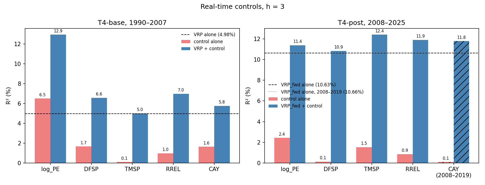

# Spec 004 — BTZ Table 4 with real-time controls

Code: `src/controls.py`, called from notebook section 4.2. It imports the spec 001, 002, 003 and 003a modules and does not modify them. The panel, units, VRP, VRP_fwd and the multivariate Hodrick 1B function (`inference_003a.hodrick_t`) are reused as they are.

## Data vintage

- `data/shiller_2026.csv`: Robert Shiller's `ie_data.xls`, sheet `Data`, columns Date, P and E. Downloaded 2026-10-21 from the link on shillerdata.com (`https://img1.wsimg.com/blobby/go/e5e77e0b-59d1-44d9-ab25-4763ac982e53/downloads/1449043e-a1ed-4e2e-8e9c-7b9a2a064493/ie_data.xls?ver=1791297298731`). 1,866 rows, 1871-01 → 2026-06. The rows after the last month with earnings (P only) are dropped. P is the monthly average of daily closes. E is 12-month trailing earnings, interpolated monthly from quarterly totals by Shiller.
- The Yale address used in the notebook (`econ.yale.edu/~shiller/data/ie_data.xls`) was also tried the same day. It still serves a file that ends in 2023-09 with E to 2023-06, the vintage of the existing `data/shiller_data.csv`, which is not modified.
- Overlap with `data/shiller_data.csv`, 1871-01 → 2023-06 (1830 months): the largest absolute difference is 0 in P and 0.16 in E.
- Unchanged frozen files: `data/baa.csv`, `data/aaa.csv`, `data/gs10.csv`, `data/tb3ms.csv` (FRED monthly averages to 2026-08), `data/cay_current.csv` (quarterly, last quarter 2019-09).

## Definitions

h = 3. Dependent variable: Y_t(3) = 1200 × the mean of the excess log returns of months t+1 … t+3, spec 001 specification (B). VRP and VRP_fwd are in monthly percent squared. NW: statsmodels HAC, Bartlett, maxlags = 2, `use_correction=False`. Hodrick 1B: `inference_003a.hodrick_t` with z_t = (1, x_t')' over the block's regressors, the null residual, and positions h−1 … n−2 of the block's months. R² in percent.

Controls, RT: log P/E = log(P_t / E_{t−3}); DFSP = BAA_t − AAA_t; TMSP = GS10_t − TB3MS_t; RREL = TB3MS_t − mean(TB3MS_{t−11} … TB3MS_t); CAY for quarter q ending in month m is assigned to months m+3, m+4, m+5. NB: log P/E = log(P_t / E_t), CAY assigned to months m, m+1, m+2; the other three are the same. FRED observations dated the first of a month are labelled at the end of that month.

Block sample: the months of the block's window on which e, the VRP measure and every control of the variant are defined. As in specs 001–003a, Y_t(3) uses only returns inside the block, so the regression rows are the first n − 3 of the block's n months.

## Checks

### 1. Shiller parsing

Pass. No duplicate date. Every year from 1990 to 2025 has 12 months, and the file is a complete monthly calendar from 1871-01 to 2026-06, so October is present in every year (155 complete years, 1871–2025). The date is read on two decimals: 1990.1 → 1990-10, 1990.01 → 1990-01, 1990.11 → 1990-11, asserted.

| month | P | E |
|---|---|---|
| 1990-09 | 315.41 | 21.7400 |
| 1990-10 | 307.12 | 21.6067 |
| 1990-11 | 315.29 | 21.4733 |

### 2. Real-time timing

Pass. Every RT control carries the source month of each input. On every month of every RT block (7,212 month × control pairs), the latest source month is ≤ t. For log P/E the earnings month is exactly t − 3 and the price month is t. For CAY the quarter used ends at least 3 months before t. The last quarter, 2019-09, is assigned to 2019-12 … 2020-02 under RT (NB: through 2019-11). The spec 001 look-ahead rule for IV, RV and the return window also passes on all 34,584 regression rows, both timings.

### 3. T4-base row (a) is the spec 001 main regression

Pass. CAY does not shorten T4-base: the block is 1990-01 → 2007-12 under both timings. Row (a) gives coef(B) = 0.4196, t NW = 3.46, R² = 4.98%, N = 213, equal to `results/001-baseline-1990/table2_main.csv` at h = 3 to 1e-8. Row (a) of the blocks whose sample is a spec 003/003a row also reproduces that row (coef, t NW, t 1B and N, to 1e-8):

| block | measure | variant | spec 003 row | coef | t NW | t 1B | N |
|---|---|---|---|---|---|---|---|
| T4-base | VRP | with CAY | R-base | 0.4196 | 3.46 | 2.22 | 213 |
| T4-95 | VRP | with CAY | V-95-07 | 0.3729 | 2.82 | 1.81 | 153 |
| T4-95 | VRP_fwd | with CAY | G-95-07 | 0.1472 | 0.99 | 0.87 | 153 |
| T4-post | VRP_fwd | without CAY | G-08-25 | 0.3925 | 5.02 | 2.75 | 213 |
| T4-full | VRP_fwd | without CAY | R-G | 0.3256 | 5.23 | 2.78 | 369 |

### 4 and 5. Same rows, no NaN, N per block

Pass. Within each block, every regression has the same row index (asserted against the block's first regression), the block's months are contiguous, and no variable of the block is NaN on them.

| timing | block | measure | variant | months | regression rows | N |
|---|---|---|---|---|---|---|
| RT | T4-base | VRP | with CAY | 1990-01 → 2007-12 | 1990-01 → 2007-09 | 213 |
| RT | T4-95 | VRP | with CAY | 1995-01 → 2007-12 | 1995-01 → 2007-09 | 153 |
| RT | T4-95 | VRP_fwd | with CAY | 1995-01 → 2007-12 | 1995-01 → 2007-09 | 153 |
| RT | T4-post | VRP_fwd | with CAY | 2008-01 → 2019-12 | 2008-01 → 2019-09 | 141 |
| RT | T4-post | VRP_fwd | without CAY | 2008-01 → 2025-12 | 2008-01 → 2025-09 | 213 |
| RT | T4-full | VRP_fwd | with CAY | 1995-01 → 2019-12 | 1995-01 → 2019-09 | 297 |
| RT | T4-full | VRP_fwd | without CAY | 1995-01 → 2025-12 | 1995-01 → 2025-09 | 369 |
| NB | T4-base | VRP | with CAY | 1990-01 → 2007-12 | 1990-01 → 2007-09 | 213 |
| NB | T4-95 | VRP | with CAY | 1995-01 → 2007-12 | 1995-01 → 2007-09 | 153 |
| NB | T4-95 | VRP_fwd | with CAY | 1995-01 → 2007-12 | 1995-01 → 2007-09 | 153 |
| NB | T4-post | VRP_fwd | with CAY | 2008-01 → 2019-11 | 2008-01 → 2019-08 | 140 |
| NB | T4-post | VRP_fwd | without CAY | 2008-01 → 2025-12 | 2008-01 → 2025-09 | 213 |
| NB | T4-full | VRP_fwd | with CAY | 1995-01 → 2019-11 | 1995-01 → 2019-08 | 296 |
| NB | T4-full | VRP_fwd | without CAY | 1995-01 → 2025-12 | 1995-01 → 2025-09 | 369 |

## RT results

Coefficients in BTZ units. All rows of a table share the same N. Full tables, with NB timing and the T4-95 and T4-full blocks, are in `table4_rt.csv` and `table4_nb.csv`.

**T4-base, VRP, with CAY.** Months 1990-01 → 2007-12, regression rows 1990-01 → 2007-09, N = 213.

| regression | coef VRP | t NW | t 1B | coef control | t NW | t 1B | R² |
|---|---|---|---|---|---|---|---|
| VRP | 0.4196 | 3.46 | 2.22 |  |  |  | 4.98 |
| log_PE |  |  |  | -26.0628 | -2.27 | -1.77 | 6.51 |
| DFSP |  |  |  | -16.7341 | -1.03 | -0.90 | 1.66 |
| TMSP |  |  |  | -0.6840 | -0.30 | -0.26 | 0.09 |
| RREL |  |  |  | 3.8926 | 1.11 | 0.92 | 0.97 |
| CAY |  |  |  | 323.9653 | 1.74 | 1.25 | 1.63 |
| VRP + log_PE | 0.4804 | 3.54 | 2.40 | -29.0293 | -2.70 | -1.91 | 12.95 |
| VRP + DFSP | 0.4168 | 3.31 | 2.23 | -16.3924 | -1.09 | -0.88 | 6.57 |
| VRP + TMSP | 0.4176 | 3.51 | 2.25 | -0.3618 | -0.16 | -0.14 | 5.01 |
| VRP + RREL | 0.4694 | 3.73 | 2.43 | 5.7059 | 1.70 | 1.33 | 6.99 |
| VRP + CAY | 0.3886 | 2.93 | 2.06 | 227.9671 | 1.16 | 0.88 | 5.76 |

All controls together, VRP + all (R² = 14.43%):

| regressor | coef | t NW | t 1B |
|---|---|---|---|
| VRP | 0.5045 | 3.47 | 2.68 |
| log_PE | -27.9039 | -2.55 | -1.69 |
| DFSP | -3.6962 | -0.26 | -0.18 |
| TMSP | 2.2304 | 1.06 | 0.81 |
| RREL | 3.4479 | 0.91 | 0.69 |
| CAY | 110.8598 | 0.56 | 0.41 |

**T4-post, VRP_fwd, without CAY.** Months 2008-01 → 2025-12, regression rows 2008-01 → 2025-09, N = 213.

| regression | coef VRP_fwd | t NW | t 1B | coef control | t NW | t 1B | R² |
|---|---|---|---|---|---|---|---|
| VRP_fwd | 0.3925 | 5.02 | 2.75 |  |  |  | 10.63 |
| log_PE |  |  |  | 12.2829 | 2.36 | 1.58 | 2.42 |
| DFSP |  |  |  | -2.3303 | -0.20 | -0.19 | 0.12 |
| TMSP |  |  |  | -3.0399 | -1.31 | -1.07 | 1.53 |
| RREL |  |  |  | 4.3311 | 0.77 | 0.58 | 0.86 |
| VRP_fwd + log_PE | 0.3693 | 5.16 | 2.53 | 7.0071 | 1.50 | 0.88 | 11.38 |
| VRP_fwd + DFSP | 0.3947 | 4.52 | 2.75 | -3.1975 | -0.39 | -0.26 | 10.85 |
| VRP_fwd + TMSP | 0.3972 | 4.40 | 2.78 | -3.2757 | -1.69 | -1.15 | 12.41 |
| VRP_fwd + RREL | 0.4008 | 4.32 | 2.79 | 5.2763 | 1.16 | 0.71 | 11.90 |

All controls together, VRP_fwd + all (R² = 14.00%):

| regressor | coef | t NW | t 1B |
|---|---|---|---|
| VRP_fwd | 0.3760 | 4.05 | 2.57 |
| log_PE | 8.1280 | 1.54 | 0.99 |
| DFSP | -0.1966 | -0.03 | -0.02 |
| TMSP | -2.7208 | -1.43 | -0.94 |
| RREL | 4.1590 | 0.96 | 0.55 |

**T4-post, VRP_fwd, with CAY.** Months 2008-01 → 2019-12, regression rows 2008-01 → 2019-09, N = 141.

| regression | coef VRP_fwd | t NW | t 1B | coef control | t NW | t 1B | R² |
|---|---|---|---|---|---|---|---|
| VRP_fwd | 0.3484 | 5.05 | 2.28 |  |  |  | 10.66 |
| log_PE |  |  |  | 10.0733 | 1.85 | 1.22 | 2.10 |
| DFSP |  |  |  | -4.4015 | -0.34 | -0.33 | 0.51 |
| TMSP |  |  |  | -3.2330 | -0.88 | -0.72 | 0.83 |
| RREL |  |  |  | 19.9142 | 1.80 | 1.30 | 9.06 |
| CAY |  |  |  | -71.6559 | -0.19 | -0.18 | 0.08 |
| VRP_fwd + log_PE | 0.3306 | 5.39 | 2.12 | 5.7006 | 1.20 | 0.67 | 11.30 |
| VRP_fwd + DFSP | 0.3529 | 4.16 | 2.30 | -5.3938 | -0.60 | -0.40 | 11.42 |
| VRP_fwd + TMSP | 0.3618 | 4.47 | 2.35 | -4.4406 | -1.50 | -0.98 | 12.22 |
| VRP_fwd + RREL | 0.3435 | 3.02 | 2.27 | 19.5887 | 2.24 | 1.28 | 19.42 |
| VRP_fwd + CAY | 0.3750 | 4.52 | 2.33 | -268.6986 | -0.77 | -0.65 | 11.79 |

All controls together, VRP_fwd + all (R² = 23.16%):

| regressor | coef | t NW | t 1B |
|---|---|---|---|
| VRP_fwd | 0.2765 | 2.67 | 1.71 |
| log_PE | 9.9069 | 1.67 | 0.92 |
| DFSP | 2.5594 | 0.28 | 0.15 |
| TMSP | -5.8387 | -1.28 | -0.88 |
| RREL | 26.4376 | 2.61 | 1.66 |
| CAY | 505.3390 | 1.15 | 1.01 |

### Against BTZ Table 4

The target cells in the spec are not filled, so they are left empty. The two notebook figures quoted in the spec are shown in parentheses.

| regression | coef VRP | BTZ | t VRP NW | t VRP 1B | BTZ | coef control | BTZ | t control NW | BTZ | R² | BTZ |
|---|---|---|---|---|---|---|---|---|---|---|---|
| VRP + log_PE | 0.4804 |  | 3.54 | 2.40 |  | -29.0293 |  | -2.70 |  | 12.95 | (16.76) |
| VRP + DFSP | 0.4168 |  | 3.31 | 2.23 |  | -16.3924 |  | -1.09 |  | 6.57 |  |
| VRP + TMSP | 0.4176 |  | 3.51 | 2.25 |  | -0.3618 |  | -0.16 |  | 5.01 |  |
| VRP + RREL | 0.4694 |  | 3.73 | 2.43 |  | 5.7059 |  | 1.70 |  | 6.99 |  |
| VRP + CAY | 0.3886 |  | 2.93 | 2.06 | (3.02) | 227.9671 |  | 1.16 |  | 5.76 |  |

### The VRP measure across blocks, RT

Hodrick 1B t of the VRP measure: alone (a), with each control (c), and with all controls (d).

| block | measure | variant | N | (a) | + log_PE | + DFSP | + TMSP | + RREL | + CAY | (d) |
|---|---|---|---|---|---|---|---|---|---|---|
| T4-base | VRP | with CAY | 213 | 2.22 | 2.40 | 2.23 | 2.25 | 2.43 | 2.06 | 2.68 |
| T4-95 | VRP | with CAY | 153 | 1.81 | 2.30 | 1.71 | 1.80 | 2.16 | 1.59 | 2.74 |
| T4-95 | VRP_fwd | with CAY | 153 | 0.87 | 2.44 | 1.00 | 0.89 | 1.60 | 0.40 | 2.53 |
| T4-post | VRP_fwd | with CAY | 141 | 2.28 | 2.12 | 2.30 | 2.35 | 2.27 | 2.33 | 1.71 |
| T4-post | VRP_fwd | without CAY | 213 | 2.75 | 2.53 | 2.75 | 2.78 | 2.79 | — | 2.57 |
| T4-full | VRP_fwd | with CAY | 297 | 2.33 | 2.46 | 2.33 | 2.33 | 2.61 | 2.36 | 2.59 |
| T4-full | VRP_fwd | without CAY | 369 | 2.78 | 2.83 | 2.78 | 2.81 | 2.99 | — | 2.99 |

## Timing: RT against NB, T4-base

Same 213 rows under both timings. Only log P/E and CAY change between the timings, so the other rows are identical.

| regression | R² RT | R² NB | NB − RT | t NW VRP RT | t NW VRP NB | t 1B VRP RT | t 1B VRP NB |
|---|---|---|---|---|---|---|---|
| VRP | 4.98 | 4.98 | 0.00 | 3.46 | 3.46 | 2.22 | 2.22 |
| log_PE | 6.51 | 8.47 | 1.96 |  |  |  |  |
| DFSP | 1.66 | 1.66 | 0.00 |  |  |  |  |
| TMSP | 0.09 | 0.09 | 0.00 |  |  |  |  |
| RREL | 0.97 | 0.97 | 0.00 |  |  |  |  |
| CAY | 1.63 | 4.52 | 2.89 |  |  |  |  |
| VRP + log_PE | 12.95 | 15.93 | 2.98 | 3.54 | 3.68 | 2.40 | 2.59 |
| VRP + DFSP | 6.57 | 6.57 | 0.00 | 3.31 | 3.31 | 2.23 | 2.23 |
| VRP + TMSP | 5.01 | 5.01 | 0.00 | 3.51 | 3.51 | 2.25 | 2.25 |
| VRP + RREL | 6.99 | 6.99 | 0.00 | 3.73 | 3.73 | 2.43 | 2.43 |
| VRP + CAY | 5.76 | 8.09 | 2.33 | 2.93 | 2.91 | 2.06 | 1.92 |
| VRP + all | 14.43 | 17.76 | 3.33 | 3.47 | 3.39 | 2.68 | 2.59 |

Audit reference, direction only (SPY, 1993-12 → 2008-01, old units): VRP + log P/E R² 17.1% NB against 13.6% with E lagged 3 months; VRP + CAY 8.6% NB against 5.7% with CAY lagged one quarter. Here: VRP + log P/E 15.93% NB against 12.95% RT; VRP + CAY 8.09% NB against 5.76% RT.

## Flags (h = 3, RT, Hodrick 1B)

| flag | holds | numbers |
|---|---|---|
| K1 BTZ robustness | yes | T4-base, t 1B of VRP: + log_PE 2.40; + DFSP 2.23; + TMSP 2.25; + RREL 2.43; + CAY 2.06 |
| K2 timing inflates the controls | yes | T4-base, R² NB − RT of VRP + control: log_PE 2.98 pp; CAY 2.33 pp (threshold 2 pp) |
| K3 post-2008 robustness | yes | T4-post, t 1B of VRP_fwd: + log_PE 2.53 (to 2025-12); + DFSP 2.75 (to 2025-12); + TMSP 2.78 (to 2025-12); + RREL 2.79 (to 2025-12); + CAY 2.33 (to 2019-12) |
| K4 kitchen sink | yes | all controls, t 1B: T4-base VRP 2.68; T4-post VRP_fwd 2.57 (T4-post without CAY) |

The flags are read as written in the spec. A flag that fails is reported with its numbers; neither the timing nor the controls were changed after the run.

## Limitations of the timing

1. **DFSP, TMSP and RREL.** BAA, AAA, GS10 and TB3MS are monthly averages of month t. FRED publishes them in the first days of month t+1, so at the end of month t the last few daily values are not yet in the average. Both timings treat them as known at t.
2. **CAY is estimated on the full sample.** The cointegrating coefficients in `cay_current.csv` (c − 0.218 a − 0.801 y + 0.441) are estimated on data to 2019. RT timing fixes the publication lag of each quarter, not the look-ahead in the coefficients, which these data cannot remove. CAY ends in 2019Q3, so the CAY versions of T4-post and T4-full end in 2019-12.
3. **Shiller E is interpolated.** Shiller builds monthly E by linear interpolation between quarterly four-quarter totals. When t − 3 is not a quarter end, E_{t−3} mixes in the next quarter's total, which ends 1 or 2 months before t and can be published after t. The 3-month lag is the spec's rule and is kept. P is the monthly average of daily closes, known at the end of month t.

## Deviations from this spec

1. The Shiller file comes from the shillerdata.com link, not the Yale address in the notebook, because the Yale file ends in 2023-09 and cannot meet check 1 for 2024–2025.
2. The spec's two statements about the end of RT CAY disagree. The RT rule assigns 2019Q3 (m = 2019-09) to months m+3 … m+5, that is 2019-12 … 2020-02, while the spec says the last usable month is 2019-12. Both are kept as written: the RT series follows the rule, and the CAY versions of T4-post and T4-full end in 2019-12, the end the spec gives three times. So 2020-01 and 2020-02 are not used.
3. Under NB timing, CAY of the last quarter covers months m … m+2, so it ends in 2019-11. The NB CAY versions of T4-post and T4-full use the block rule (months where every variable is defined) and therefore end in 2019-11, one month earlier than the RT versions. T4-base is not affected.
4. Y_t(3) only uses returns inside the block, as in specs 001–003a, so a block ending in 2019-12 has its last regression row in 2019-09. This is what check 3 requires (N = 213 on 1990–2007).
5. The SUMMARY also reports, for row (a), the agreement with the spec 003/003a rows on the same sample, and a compact table of the VRP measure's 1B t across all blocks. These are additions.

