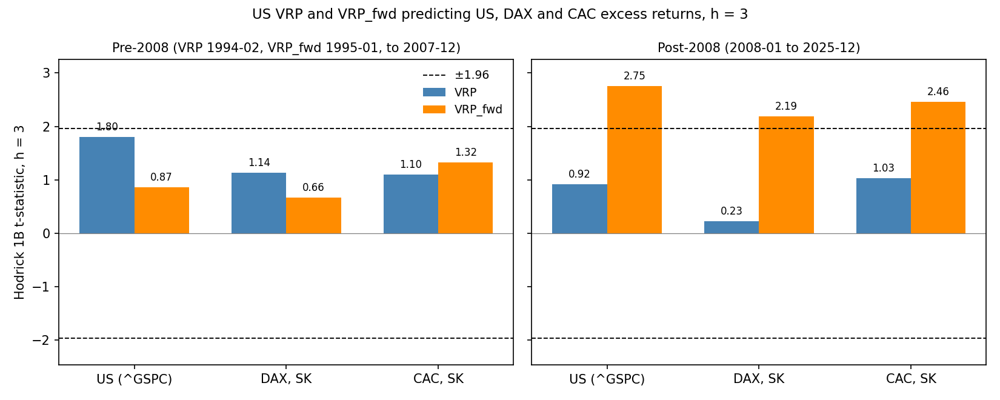

# Spec 005 — European extension: does the US VRP predict DAX and CAC returns?

Code: `src/europe.py`, called from notebook section 5.2. It imports the spec 001, 002, 003 and 003a modules and does not modify them. VRP and VRP_fwd are the spec 001 and spec 002 series (`inference._load`). The US rows and the NB and T−1 rows go through `inference.run_row` (spec 001 Y, statsmodels NW, `inference.hodrick_t`), and their bootstrap is `inference.simulate_null` (iid) and `inference_003a.simulate_wild` (wild) with `inference_003a._boot_stats`. The SK rows need a day-1 term in the 1B score and in the null draws; see Deviations.

## Indices and data

- **Index definitions.** `^GDAXI` (DAX) is a performance index: dividends are reinvested, so it is a total-return index. `^FCHI` (CAC 40) and `^GSPC` (S&P 500) are price indices. All returns are log returns in local currency (EUR for DAX and CAC, USD for the US), with no currency conversion. A constant dividend yield shifts the intercept of the regression, not the slope, so the index type does not explain a difference in coefficients.
- **Risk-free rate.** `data/euribor.csv` is FRED IR3TIB01EZM156N, the 3-month interbank rate, monthly, percent per year. Before 1999 it is the OECD synthetic euro-area series, not a traded Euribor. rf^EU_t = Euribor_{t−1} / 1200, the one-month lag of the US rf; the first usable month is 1994-02.
- **Daily files.** `data/dax.csv` (8,360 days, 1993-01-04 → 2025-12-30) and `data/cac.csv` (8,395 days, 1993-01-04 → 2025-12-31), Close column, unchanged. US side: the spec 001 panel (`^GSPC`, `data/vix_1990_data.csv`, TB3MS lagged one month) and the spec 002 VRP_fwd.

## Definitions

T_m and F_m are the last and first European trading days of month m, from the market's own daily file. **NB**: e_m = log(P(T_m)/P(T_{m−1})) − rf^EU_m and Y^NB_t(h) = (1200/h) Σ_{j=1..h} e_{t+j}, as spec 001. **SK**: Y^SK_t(h) = (1200/h)[log(P(T_{t+h})/P(F_{t+1})) − Σ_{j=1..h} rf^EU_{t+j}]. Writing d_m = log(P(F_m)/P(T_{m−1})), Y^SK_t(h) = Y^NB_t(h) − 1200·d_{t+1}/h. **T−1**: VRP^{T−1}_t is the spec 001 VRP with the US daily returns and the VIX close up to the penultimate `^GSPC` trading day of month t, paired with Y^NB; raw VRP only. **US benchmark**: `^GSPC` with the spec 001 Y on the same months.

Samples, regressor months t: pre-2008 is 1994-02 → 2007-12 for VRP and 1995-01 → 2007-12 for VRP_fwd; post-2008 is 2008-01 → 2025-12. As in specs 001–003a, Y_t(h) only uses returns inside the sample, so N = months − h. VRP_fwd starts in 1995-01, so its pre-2008 rows run from 1995-01 to 2007-12.

Statistics: coef(B) in BTZ units (annualized % per monthly %²); t NW with maxlags = max(1, h−1), Bartlett, no small-sample correction; t Hodrick 1B with the null residual on positions h−1 … n−2; bootstrap p-values of the NW t, spec 003 C3 null (AR(1) regressor, constant mean return), 5,000 replications each for iid and wild, all from one `numpy.random.default_rng(20261021)` in the row order of `table_europe.csv`, iid then wild within a row. Standardized coefficient = coef(B) × sd(x) / sd(Y) on the regression rows. coef / sd(e) divides coef(B) by the standard deviation of the market's monthly excess return (NB definition, × 1200) over the regression-row months t.

For a univariate OLS regression, coef × sd(x) / sd(Y) is the sample correlation of x and Y, that is sign(coef) × √R². The code asserts this on every row (1e-9). E4 therefore compares the correlations of the US VRP with US and DAX returns.

## Checks

### 1. US benchmark

Pass. On both samples and at h = 1, 3, 6, the US VRP rows equal `baseline_1990.run_sample` on the same months, and the US VRP_fwd rows equal `influence.run_regression` (coef(B), t NW(h−1), R² and N, to 1e-8). Against `results/003-inference/table_inference.csv` (003a), to 1e-06 on coef(B), t NW(h−1) and t 1B, with the same N:

| 003a row | h | coef(B) | t NW(h−1) | t 1B | N | largest gap | source |
|---|---|---|---|---|---|---|---|
| V-95-07 | 1 | 0.3640 | 1.37 | 1.22 | 155 | 0.0e+00 | check-only fit, 1995-01 → 2007-12 |
| V-95-07 | 3 | 0.3729 | 2.82 | 1.81 | 153 | 0.0e+00 | check-only fit, 1995-01 → 2007-12 |
| V-95-07 | 6 | 0.2838 | 2.76 | 1.69 | 150 | 4.4e-16 | check-only fit, 1995-01 → 2007-12 |
| G-95-07 | 1 | 0.1940 | 0.68 | 0.63 | 155 | 2.8e-17 | table row |
| G-95-07 | 3 | 0.1472 | 0.99 | 0.87 | 153 | 2.8e-17 | table row |
| G-95-07 | 6 | 0.0676 | 0.72 | 0.49 | 150 | 5.6e-17 | table row |
| V-08-25 | 1 | 0.0453 | 0.21 | 0.26 | 215 | 5.6e-17 | table row |
| V-08-25 | 3 | 0.0673 | 0.51 | 0.92 | 213 | 1.1e-16 | table row |
| V-08-25 | 6 | 0.0178 | 0.26 | 0.32 | 210 | 5.6e-17 | table row |
| G-08-25 | 1 | 0.5041 | 3.37 | 1.99 | 215 | 0.0e+00 | table row |
| G-08-25 | 3 | 0.3925 | 5.02 | 2.75 | 213 | 5.6e-17 | table row |
| G-08-25 | 6 | 0.2339 | 3.27 | 2.32 | 210 | 4.4e-16 | table row |

G-95-07, V-08-25 and G-08-25 are rows of `table_europe.csv`. The pre-2008 VRP row starts in 1994-02, so V-95-07 is checked on a separate fit over 1995-01 → 2007-12 through the same code path.

### 2. Daily data quality, 1994–2025

- **DAX**: every month has at least 15 trading days (pass; fewest 17, in 2001-12). Daily |log return| > 10%: 2008-10-13 (+10.80%), 2008-10-28 (+10.69%), 2020-03-12 (-13.05%), 2020-03-24 (+10.41%). Months with zero volume on every day (information only): 70 months, 1994-01 → 1999-10, one unbroken run at the start of the file.
- **CAC**: every month has at least 15 trading days (pass; fewest 17, in 2012-12). Daily |log return| > 10%: 2008-10-13 (+10.59%), 2020-03-12 (-13.10%). Months with zero volume on every day (information only): 129 months, 1994-01 → 2004-09, one unbroken run at the start of the file.

The full lists are in `table_data_quality.csv`. The large daily moves fall in 2008-10, 2020-03; the same days appear in both files.

### 3. SK timing

Pass, on all 4,450 SK regression rows (DAX and CAC, VRP and VRP_fwd, both samples, h = 1, 3, 6). For every row t, F_{t+1} is strictly after the last `^GSPC` trading day of month t. Y^SK is recomputed from the two prices P(F_{t+1}) and P(T_{t+h}) and the h Euribor terms, and equals the regression Y to 1e-9; F_{t+1} is in month t+1, T_{t+h} in month t+h, and F_{t+1} ≤ T_{t+h}. So every price in Y^SK is dated in [F_{t+1}, T_{t+h}].

### 4. T−1 timing

Pass as written. The latest US date inside VRP^{T−1}_t is the penultimate `^GSPC` day of month t (asserted for RV and IV). In every row it is either before T_t, or equal to T_t in a month where the European and US last days differ. No month has the penultimate US day after T_t.

| market | sample | rows (h = 1) | penultimate US day < T_t | = T_t (last days differ) | months with equality |
|---|---|---|---|---|---|
| DAX | pre-2008 | 166 | 157 | 9 | 1996-12, 1997-03, 1997-12, 1998-12, 1999-12, 2001-12, 2002-12, 2003-12, 2004-12 |
| CAC | pre-2008 | 166 | 161 | 5 | 1994-10, 1997-03, 1998-12, 1999-12, 2001-12 |
| DAX | post-2008 | 215 | 202 | 13 | 2008-12, 2009-12, 2010-12, 2012-12, 2013-12, 2014-12, 2015-12, 2017-10, 2018-12, 2019-12, 2020-12, 2021-12, 2024-12 |
| CAC | post-2008 | 215 | 212 | 3 | 2010-12, 2012-12, 2015-12 |

When the dates are equal, the US close on that day (22:00 CET) is still after the European close (17:30 CET). In those months VRP^{T−1}_t is not known before T_t, so T−1 does not remove the overlap there. They are mostly Decembers, when Xetra or Euronext close before 31 December.

### 5. No NaN, N

Pass. e, d (SK), the regressor, Y and the US date columns are finite on every regression sample (asserted per row and horizon), and N = months − h everywhere. The spec 001 look-ahead rule (`influence.assert_row_timing`) also passes on every row.

| sample | regressor | months | N, h = 1 | h = 3 | h = 6 |
|---|---|---|---|---|---|
| pre-2008 | VRP | 1994-02 → 2007-12 (167) | 166 | 164 | 161 |
| pre-2008 | VRP_fwd | 1995-01 → 2007-12 (156) | 155 | 153 | 150 |
| post-2008 | VRP | 2008-01 → 2025-12 (216) | 215 | 213 | 210 |
| post-2008 | VRP_fwd | 2008-01 → 2025-12 (216) | 215 | 213 | 210 |

VRP_fwd starts in 1995-01, so its pre-2008 rows run from 1995-01 to 2007-12. N is the same for every market and timing within a sample and regressor.

## Results at h = 3

coef(B) in BTZ units. p iid and p wild are bootstrap p-values of the NW t. Std coef = coef × sd(x)/sd(Y). R² in percent. VRP_fwd starts in 1995-01, so its pre-2008 rows run from 1995-01 to 2007-12. US rows use the spec 001 timing. h = 1 and 6 are in `table_europe.csv`.

| market | regressor | timing | sample | coef(B) | t NW | t 1B | p iid | p wild | R² | N | std coef | coef / sd(e) |
|---|---|---|---|---|---|---|---|---|---|---|---|---|
| US | VRP | spec 001 | 1994-02 → 2007-12 | 0.3701 | 2.80 | 1.80 | 0.0182 | 0.0276 | 4.15 | 164 | 0.204 | 0.00759 |
| US | VRP_fwd | spec 001 | 1995-01 → 2007-12 | 0.1472 | 0.99 | 0.87 | 0.3932 | 0.4276 | 0.73 | 153 | 0.086 | 0.00297 |
| DAX | VRP | NB | 1994-02 → 2007-12 | 0.4730 | 2.64 | 1.25 | 0.0244 | 0.0408 | 2.36 | 164 | 0.154 | 0.00605 |
| DAX | VRP | SK | 1994-02 → 2007-12 | 0.4339 | 2.53 | 1.14 | 0.0312 | 0.0526 | 2.03 | 164 | 0.142 | 0.00555 |
| DAX | VRP | T−1 | 1994-02 → 2007-12 | 0.4551 | 2.49 | 1.25 | 0.0322 | 0.0612 | 2.24 | 164 | 0.150 | 0.00582 |
| DAX | VRP_fwd | NB | 1995-01 → 2007-12 | 0.1656 | 0.85 | 0.59 | 0.4718 | 0.4646 | 0.32 | 153 | 0.057 | 0.00209 |
| DAX | VRP_fwd | SK | 1995-01 → 2007-12 | 0.1849 | 0.91 | 0.66 | 0.4390 | 0.4598 | 0.41 | 153 | 0.064 | 0.00233 |
| CAC | VRP | NB | 1994-02 → 2007-12 | 0.3704 | 2.35 | 1.19 | 0.0408 | 0.0580 | 2.02 | 164 | 0.142 | 0.00557 |
| CAC | VRP | SK | 1994-02 → 2007-12 | 0.3398 | 2.09 | 1.10 | 0.0672 | 0.0972 | 1.73 | 164 | 0.131 | 0.00511 |
| CAC | VRP | T−1 | 1994-02 → 2007-12 | 0.3636 | 2.23 | 1.18 | 0.0564 | 0.0842 | 1.99 | 164 | 0.141 | 0.00547 |
| CAC | VRP_fwd | NB | 1995-01 → 2007-12 | 0.2969 | 1.57 | 1.28 | 0.1758 | 0.2366 | 1.50 | 153 | 0.122 | 0.00452 |
| CAC | VRP_fwd | SK | 1995-01 → 2007-12 | 0.2957 | 1.48 | 1.32 | 0.1952 | 0.2612 | 1.50 | 153 | 0.123 | 0.00450 |
| US | VRP | spec 001 | 2008-01 → 2025-12 | 0.0673 | 0.51 | 0.92 | 0.6894 | 0.7202 | 1.06 | 213 | 0.103 | 0.00122 |
| US | VRP_fwd | spec 001 | 2008-01 → 2025-12 | 0.3925 | 5.02 | 2.75 | 0.0008 | 0.0086 | 10.63 | 213 | 0.326 | 0.00710 |
| DAX | VRP | NB | 2008-01 → 2025-12 | 0.0380 | 0.29 | 0.48 | 0.8190 | 0.8286 | 0.25 | 213 | 0.050 | 0.00059 |
| DAX | VRP | SK | 2008-01 → 2025-12 | 0.0205 | 0.14 | 0.23 | 0.9120 | 0.9196 | 0.07 | 213 | 0.027 | 0.00032 |
| DAX | VRP | T−1 | 2008-01 → 2025-12 | 0.0310 | 0.22 | 0.37 | 0.8556 | 0.8720 | 0.14 | 213 | 0.038 | 0.00048 |
| DAX | VRP_fwd | NB | 2008-01 → 2025-12 | 0.3581 | 4.27 | 2.23 | 0.0044 | 0.0154 | 6.61 | 213 | 0.257 | 0.00554 |
| DAX | VRP_fwd | SK | 2008-01 → 2025-12 | 0.3594 | 4.19 | 2.19 | 0.0050 | 0.0192 | 6.68 | 213 | 0.259 | 0.00556 |
| CAC | VRP | NB | 2008-01 → 2025-12 | 0.0917 | 0.74 | 1.46 | 0.5470 | 0.5380 | 1.63 | 213 | 0.128 | 0.00151 |
| CAC | VRP | SK | 2008-01 → 2025-12 | 0.0736 | 0.55 | 1.03 | 0.6764 | 0.6862 | 1.05 | 213 | 0.102 | 0.00121 |
| CAC | VRP | T−1 | 2008-01 → 2025-12 | 0.0872 | 0.68 | 1.34 | 0.5980 | 0.5884 | 1.24 | 213 | 0.111 | 0.00144 |
| CAC | VRP_fwd | NB | 2008-01 → 2025-12 | 0.3482 | 4.89 | 2.50 | 0.0016 | 0.0018 | 6.94 | 213 | 0.263 | 0.00574 |
| CAC | VRP_fwd | SK | 2008-01 → 2025-12 | 0.3490 | 4.84 | 2.46 | 0.0030 | 0.0034 | 6.95 | 213 | 0.264 | 0.00576 |

### Timing, raw VRP, h = 3

Samples 1994-02 → 2007-12 and 2008-01 → 2025-12 (raw VRP only, so no VRP_fwd start applies).

| market | sample | N | coef NB | coef SK | coef T−1 | t 1B NB | t 1B SK | t 1B T−1 | SK − NB | T−1 − NB |
|---|---|---|---|---|---|---|---|---|---|---|
| DAX | pre-2008 | 164 | 0.4730 | 0.4339 | 0.4551 | 1.25 | 1.14 | 1.25 | -0.11 | 0.01 |
| DAX | post-2008 | 213 | 0.0380 | 0.0205 | 0.0310 | 0.48 | 0.23 | 0.37 | -0.25 | -0.11 |
| CAC | pre-2008 | 164 | 0.3704 | 0.3398 | 0.3636 | 1.19 | 1.10 | 1.18 | -0.09 | -0.01 |
| CAC | post-2008 | 213 | 0.0917 | 0.0736 | 0.0872 | 1.46 | 1.03 | 1.34 | -0.43 | -0.12 |

Audit reference (direction only, not targets): SPY-based VRP, notebook units, NW, h = 3, 1994–2007. The comparable figures here are the NW t on the pre-2008 rows, with `^GSPC`, BTZ units and the lagged rf:

| market | NB audit | NB here | T−1 audit | T−1 here | SK audit | SK here |
|---|---|---|---|---|---|---|
| DAX | 2.64 | 2.64 | 2.59 | 2.49 | 2.79 | 2.53 |
| CAC | 2.05 | 2.35 | 2.02 | 2.23 | 2.18 | 2.09 |

Monthly excess-return volatility on the pre-2008 regression months (1994-02 → 2007-09 at h = 3), in % per month: US 4.07 (audit 4.02), DAX 6.51 (audit 6.45), CAC 5.54 (audit 5.48). The audit figures are monthly return volatilities on 1994–2007, with SPY for the US.

## Reading the coefficients

Pre-2008, raw VRP, h = 3 (SK for DAX and CAC): coef(B) is 0.370 for the US, 0.434 for the DAX and 0.340 for the CAC. The monthly excess-return standard deviations on the same rows are 4.07%, 6.51% and 5.54%. Scaled by them, coef / sd(e) is 0.00759, 0.00555 and 0.00511, and the standardized coefficients are 0.204, 0.142 and 0.131. The DAX raw coefficient is 17% above the US one, its volatility-scaled coefficient 27% below and its standardized coefficient 30% below. The raw coefficient is in annualized percent of the index's own return, so it grows with the index's volatility; the scaled coefficients and E4 compare sensitivities. The dividend treatment cannot explain a slope difference: `^GDAXI` reinvests dividends and `^FCHI` and `^GSPC` do not, but a constant dividend yield only moves the intercept.

## Flags (h = 3, Hodrick 1B)

Fixed before the run. Every condition within a flag is joined by **and**. p iid and p wild are the bootstrap p-values of the NW t.

| flag | holds | numbers |
|---|---|---|
| E1 timing is immaterial | no | raw VRP, \|Δt 1B\| < 0.3: DAX pre-2008: SK − NB -0.11, T−1 − NB 0.01 (yes); DAX post-2008: SK − NB -0.25, T−1 − NB -0.11 (yes); CAC pre-2008: SK − NB -0.09, T−1 − NB -0.01 (yes); CAC post-2008: SK − NB -0.43, T−1 − NB -0.12 (no) |
| E2 pre-2008 spillover | no | VRP, SK, 1994-02 → 2007-12: DAX t 1B 1.14, p iid 0.0312, p wild 0.0526 (no); CAC t 1B 1.10, p iid 0.0672, p wild 0.0972 (no) |
| E3 post-2008 spillover | yes | VRP_fwd, SK, 2008-01 → 2025-12: DAX t 1B 2.19, p iid 0.0050, p wild 0.0192 (yes); CAC t 1B 2.46, p iid 0.0030, p wild 0.0034 (yes) |
| E4 no extra sensitivity | no | 1994-02 → 2007-12, raw VRP: std coef DAX (SK) 0.142, US 0.204, DAX / US − 1 = -30.1% (band ±25%) |

A flag that fails is reported with its numbers. The timing, the indices and the samples were not changed after the run.

## Deviations from this spec

1. **Hodrick 1B and the bootstrap for SK.** Y^SK is not a forward average of one monthly series, so `inference.hodrick_t` and the spec 003 null draws do not apply to it directly. `hodrick_t_skip` adds the day-1 term: the 1B score at position p is u_{p+1}·Σ_{i<h} z_{p−i} − δ_{p+1}·z_p, with δ the demeaned day-1 return d. With d = 0 it equals `inference.hodrick_t` to 1e-12, and at h = 1 it equals `inference.hodrick_t` on e − d (both asserted on simulated data). `simulate_skip` draws δ_s with the same index (iid) or the same Rademacher weight (wild) as (ε_s, η_s). From the same generator state, its e* and x* are identical to `inference.simulate_null` and `inference_003a.simulate_wild`, and it consumes the generator identically (asserted).
2. **Check 4.** The spec's first sentence asks for the latest US date to be strictly before T_t, and its second admits equality when the last days differ. The code asserts the second, more precise reading and reports the months with equality. In those months the US close on the penultimate day is after the European close on the same day.
3. **coef / sd(e).** "The same rows" is read as the regression-row months t, with the market's NB monthly excess return in annualized percent. For the SK rows the same NB monthly series is used, because it is the market's monthly excess return.
4. **Check 1, V-95-07.** The table's pre-2008 VRP rows start in 1994-02, as the spec requires, so V-95-07 (1995-01 → 2007-12) is reproduced by a separate fit through the same code. It is not a table row.
5. **Bootstrap draws.** The US rows G-95-07, V-08-25 and G-08-25 are redrawn from the spec 005 generator, so their p-values can differ in the last digits from 003a. Check 1 covers coef, t NW, t 1B and N only.
6. **Notebook numbering.** The old section 5 already has a "5.2 Results" heading. It is left unchanged. The new section is titled "5.2 European extension on the BTZ pipeline (spec 005)" and placed after the old section, and the note at the top of section 5 points to it by that title.
7. `table_europe.csv` adds sd_x, sd_Y, sd_e_ann, first_row, last_row and a note column (the VRP_fwd start) to the statistics the spec lists. `table_data_quality.csv` holds the three lists of check 2 in one file, with a `check` column.

